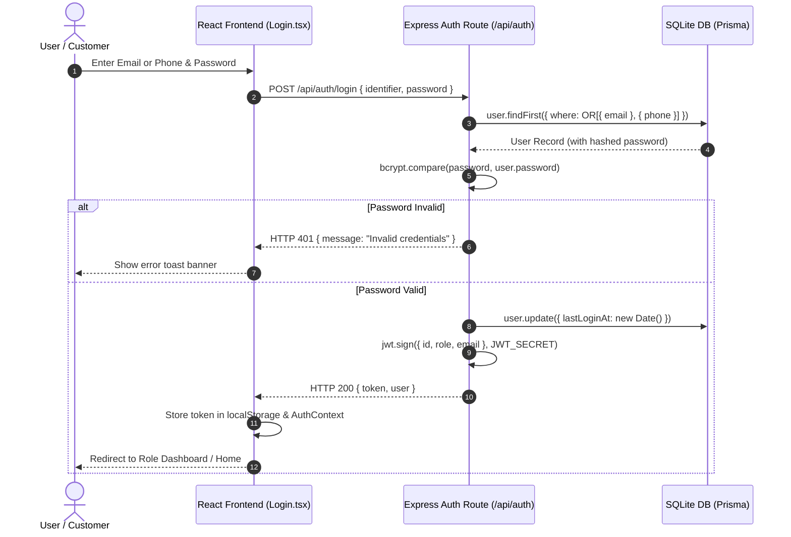
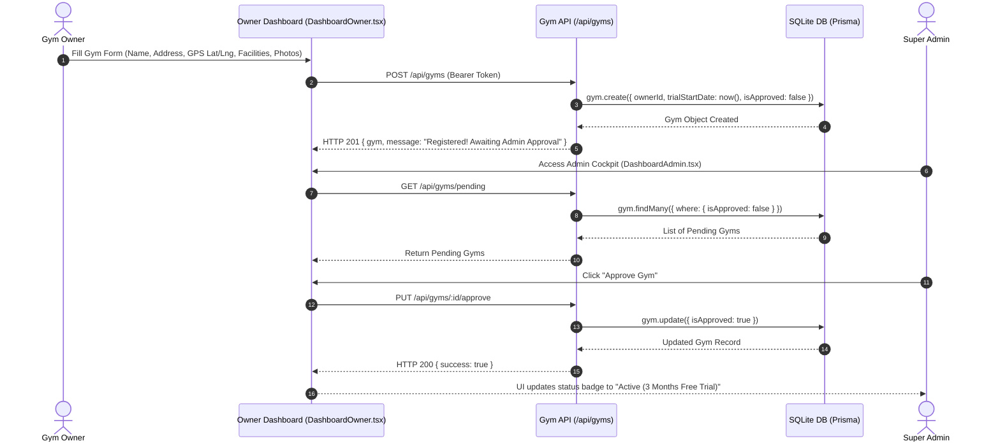
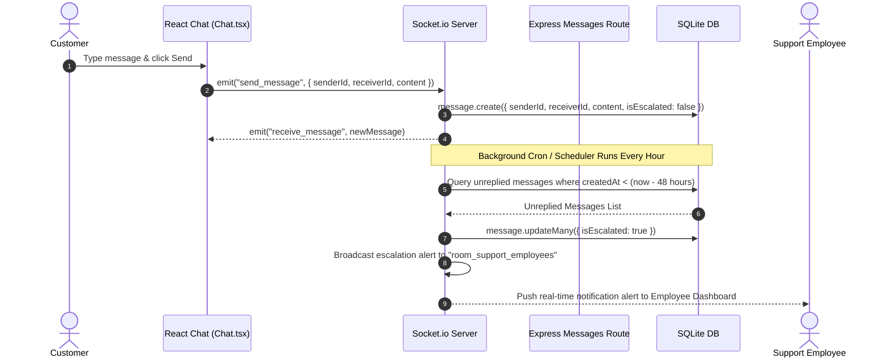
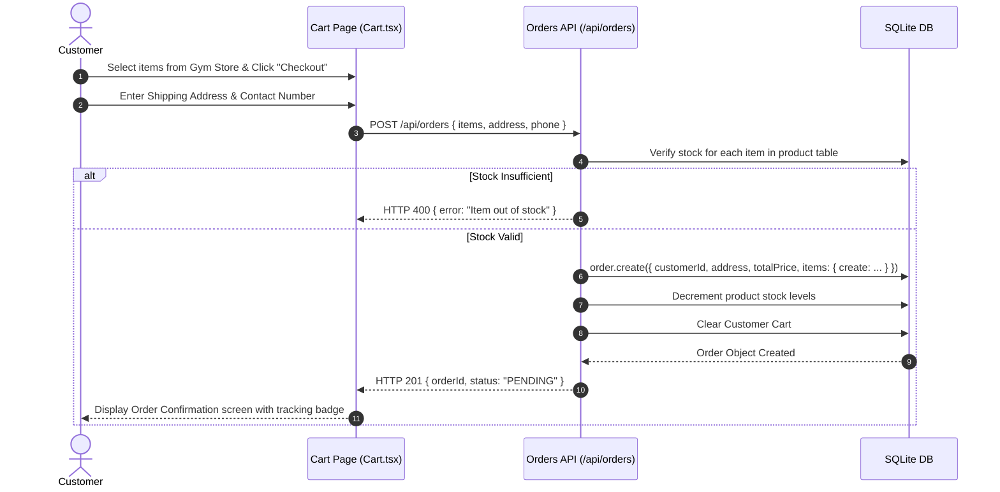
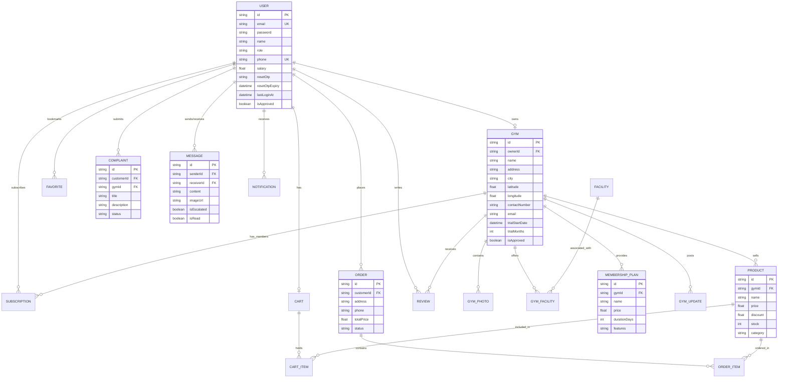

# Comprehensive PRD, Architecture & Technical Workflow Specification
**Project Name:** GymConnect ("Gym Near Me")  
**Version:** 2.0.0  
**Target Platform:** Web Desktop & Mobile Responsive  

---

## 1. Executive Summary & Product Vision

**GymConnect** (branded as **"Gym Near Me"**) is a full-stack, enterprise-grade fitness ecosystem designed to bridge the gap between gym-goers, gym owners, support staff, and platform administrators.

### Core Objectives:
1. **Seamless Gym Discovery:** Empower customers to instantly find nearest gyms using HTML5 Geolocation and interactive Leaflet maps with real-time distance calculations.
2. **Gated Information Security:** Protect proprietary gym data (membership plans, interior photos, updates, reviews, and owner messaging) by enforcing a gated authentication model for unregistered users while serving high-level public summaries.
3. **Owner Empowerment & Monetization:** Allow gym owners to self-register with a **3-Month Platform Free Trial**, manage multi-category equipment/supplement stores, customize membership plans, and upload rich gallery media.
4. **Unified Multi-Currency E-Commerce:** Global support for dynamic pricing in INR (₹), USD ($), EUR (€), GBP (£), and AED.
5. **Real-Time Communication & Automated Escalations:** Socket.io powered instant messaging between customers, owners, and support staff, complete with image uploads and automated **48-hour (2-day) unreplied message escalation** to support & admin channels.
6. **Support Staff & Payroll Management:** Specialized Employee portal with administrative payroll monitoring, salary configuration, and ticket resolution workflows.
7. **Super Admin Cockpit:** Total control over platform listing fees (₹), gym verification/approval, complaint management, employee approval, and trial duration overrides.

---

## 2. High-Level Architecture Overview

GymConnect utilizes a decoupled **Client-Server Architecture** operating over HTTP REST and WebSocket protocols with an Object-Relational Mapping (ORM) database layer.

```mermaid
graph TD
    subgraph Client Layer (Frontend React + Vite)
        A[Customer UI] -->|HTTP / REST| E[Express API Gateway]
        B[Gym Owner Dashboard] -->|HTTP / REST| E
        C[Employee Dashboard] -->|HTTP / REST| E
        D[Admin Cockpit] -->|HTTP / REST| E
        
        A <-->|WebSockets / Socket.io| F[Socket.io Server]
        B <-->|WebSockets / Socket.io| F
        C <-->|WebSockets / Socket.io| F
        D <-->|WebSockets / Socket.io| F
    end

    subgraph Application Server (Node.js + Express)
        E --> G[JWT Authentication & RBAC Middleware]
        G --> H[Route Handlers]
        H -->|Queries & Mutations| I[Prisma ORM Client]
        F -->|Real-Time Broadcasts| H
    end

    subgraph Data Persistence Layer
        I <--> J[(SQLite Database: dev.db)]
        H <--> K[Static Files / Uploads Storage]
    end
```

### Layer Breakdown:
- **Presentation Layer (Frontend):** Built with React 19, TypeScript, and Vite. Implements Vanilla CSS with glassmorphism, responsive CSS Grid/Flexbox layouts, context-driven state management (`AuthContext`, `CartContext`, `CurrencyContext`), and interactive Leaflet OpenStreetMap components.
- **API & Event Gateway (Backend):** Built with Node.js & Express. HTTP REST endpoints handle structured CRUD operations, file uploads via `multer`, password hashing with `bcryptjs`, and stateless auth with `jsonwebtoken`.
- **Real-Time Engine:** Socket.io WebSocket server managing bidirectional peer-to-peer chat rooms, unread badges, user typing statuses, and automated SLA escalation alerts.
- **ORM & Data Persistence Layer:** Prisma ORM connected to SQLite (`dev.db`). Prisma provides strong type safety, automated migrations, declarative schema definitions, and relation cascading.

---

## 3. Comprehensive Package & Dependency Analysis

### 3.1 Frontend Dependencies (`frontend/package.json`)

| Package Name | Category | Purpose & Technical Role |
| :--- | :--- | :--- |
| `react` (`^19.2.8`) | Core Framework | UI component declarative framework using modern hooks (`useState`, `useEffect`, `useContext`, `useMemo`). |
| `react-dom` (`^19.2.8`) | Rendering Engine | DOM rendering engine binding React components to the web browser tree. |
| `react-router-dom` (`^6.26.1`) | Routing | Client-side Single Page Application (SPA) routing, handling route parameters, dynamic navigation, and protected routes. |
| `lucide-react` (`^0.435.0`) | UI Components | Lightweight SVG icon library rendering clean visual icons across navigation, actions, and status badges. |
| `socket.io-client` (`^4.7.5`) | WebSockets | Real-time WebSocket client managing persistent connection to backend socket server, message listeners, and socket reconnection logic. |
| `leaflet` (`^1.9.4`) | Mapping | Interactive OpenStreetMap library rendering maps, custom markers, popups, and radius circles without third-party API key costs. |
| `@types/node` | Dev Tooling | TypeScript type definitions for Node environments. |
| `@types/react` | Dev Tooling | TypeScript type definitions for React 19 API. |
| `@types/leaflet` | Dev Tooling | Type definitions for Leaflet map instances, markers, and layer groups. |
| `@vitejs/plugin-react` | Build Tool | Official Vite plugin providing Fast Refresh and JSX transformation during development. |
| `typescript` (`~6.0.2`) | Language | Static typing compiler providing strict type checks across all frontend pages and contexts. |
| `vite` (`^8.2.2`) | Build / Bundler | Next-generation frontend build engine providing ultra-fast HMR and optimized production bundling. |
| `oxlint` (`^1.79.0`) | Linter | High-performance Rust-based linter for enforcing code quality. |

---

### 3.2 Backend Dependencies (`backend/package.json`)

| Package Name | Category | Purpose & Technical Role |
| :--- | :--- | :--- |
| `express` (`^4.18.3`) | Server Framework | Node.js web application framework serving RESTful API routes, JSON body parsing, and request handling. |
| `@prisma/client` (`^5.10.2`) | Database Client | Auto-generated, type-safe database query builder interacting with SQLite. |
| `prisma` (`^5.10.2`) | CLI & Migration | CLI tool for running schema migrations (`prisma db push`), database seeding (`prisma db seed`), and schema introspection. |
| `jsonwebtoken` (`^9.0.2`) | Security / Auth | Generates and verifies HMAC-SHA256 signed JSON Web Tokens (JWT) for stateless user authentication. |
| `bcryptjs` (`^2.4.3`) | Cryptography | One-way password hashing algorithm (salted bcrypt) for secure credential storage. |
| `cors` (`^2.8.5`) | Middleware | Cross-Origin Resource Sharing middleware enabling secure API access from `localhost:5173`. |
| `dotenv` (`^16.4.5`) | Configuration | Environment variable management loading configurations from `.env` (e.g., `PORT`, `JWT_SECRET`, `ADMIN_PASSWORD`). |
| `multer` (`^1.4.5-lts.1`) | File Storage | Handling `multipart/form-data` uploads for gym photo galleries, cover images, product thumbnails, and chat image attachments. |
| `socket.io` (`^4.7.5`) | WebSockets | Server-side WebSocket engine handling real-time rooms, events (`send_message`, `receive_message`), and room broadcasting. |
| `nodemon` (`^3.1.0`) | Dev Tooling | Development utility auto-restarting Node.js server upon backend source code edits. |

---

## 4. Deep Feature Analysis & Specification

### 4.1 Multi-Role Role-Based Access Control (RBAC)
The application enforces strict RBAC across 4 distinct roles:
1. **`CUSTOMER`**: Can search gyms, view gated profile content upon login, purchase memberships, buy store products, write reviews, file complaints, chat with gym owners, and interact with support.
2. **`GYM_OWNER`**: Registered gym owner managing individual gym profiles, photo galleries, membership plans, product store listings, customer order fulfillment, and member reviews. Enjoys a **3-Month Platform Free Trial** before subscription billing applies.
3. **`EMPLOYEE`**: Administrative support staff approved by Super Admin. Accesses support chat channels, handles escalated customer tickets, monitors order escalations, and receives set salary compensation.
4. **`ADMIN`**: Platform Super Admin (`utkarsht721@gmail.com`). Holds absolute authority: approving/rejecting gyms, approving support employees, setting platform listing fees (₹), managing employee salaries, deleting fake accounts, adjusting trial durations, and reviewing platform analytics.

---

### 4.2 Dual Authentication & Account Recovery System
- **Flexible Login Credentials:** Users can log in using either **Email Address** OR **Phone Number** alongside their secret password.
- **Stateless JWT Authorization:** API requests attach standard Bearer Tokens (`Authorization: Bearer <token>`). Tokens encode `id`, `email`, `role`, and `name`.
- **OTP-Based Email Password Recovery:**
  - If a user forgets their password, they input their registered email/phone.
  - The backend generates a 6-digit cryptographic OTP saved with a 15-minute expiration timestamp (`resetOtpExpiry`).
  - Upon verifying the OTP, the user sets a new password securely hashed via `bcryptjs`.

---

### 4.3 Interactive "Gym Near Me" Discovery & Mapping Engine
- **Geolocation Integration:** Requests user HTML5 browser coordinates (`navigator.geolocation.getCurrentPosition`).
- **Distance Calculation Algorithm:** Uses the Haversine formula to compute exact distance in kilometers ($km$) between customer coordinates $(\text{lat}_1, \text{lng}_1)$ and gym coordinates $(\text{lat}_2, \text{lng}_2)$:
  $$d = 2R \cdot \arcsin\left(\sqrt{\sin^2\left(\frac{\Delta\phi}{2}\right) + \cos(\phi_1)\cos(\phi_2)\sin^2\left(\frac{\Delta\lambda}{2}\right)}\right)$$
- **Leaflet OpenStreetMap View:** Renders an interactive map featuring marker pins for every registered gym with custom popup tooltips, contact previews, and distance radius highlights.
- **Multi-Filter System:** Filter gyms dynamically by distance radius ($5\text{km}, 10\text{km}, 25\text{km}, 50\text{km}+$), search keyword, city, and active facilities (Cardio, Sauna, Swimming Pool, Crossfit, Personal Trainers).

---

### 4.4 Gated Gym Detail Security Model
To maximize user conversion while protecting partner privacy:
- **Unauthenticated Visitors (`Public Mode`):**
  - Displays high-level summary cards: Gym Name, Cover Image, City, Star Rating, and masked phone/email preview.
  - Hides pricing details, full address, equipment photos, membership plans, customer reviews, and direct chat buttons.
  - Displays a clean callout banner prompting visitors to **Sign In** or **Create an Account** to unlock complete gym information.
- **Authenticated Users (`Full Access Mode`):**
  - Unlocks full high-res photo gallery (Interior, Exterior, Equipment).
  - Unlocks tier-based membership plans (Basic, Standard, Pro Annual) with instant checkout buttons.
  - Unlocks owner updates, real-time customer review feed, facility checklists, and 1-on-1 direct messaging with the Gym Owner.

---

### 4.5 Dynamic Multi-Currency Engine (`CurrencyContext.tsx`)
- **Global Currency Switcher:** Navbar dropdown allows instant toggling between **INR (₹)**, **USD ($)**, **EUR (€)**, **GBP (£)**, and **AED**.
- **Real-Time Price Conversion:** All prices stored in base currency (INR ₹) are automatically converted across the entire frontend (Membership Plans, E-Commerce Store Products, Orders, Admin Fee Settings, and Employee Salaries) using dynamic exchange multipliers.

---

### 4.6 Gym Store & Unified E-Commerce Infrastructure
- **Gym Owner Store Management:** Gym owners can upload physical store items under 4 major categories:
  1. **Equipment** (Dumbbells, Benches, Resistance Bands)
  2. **Apparel** (Gym Tees, Hoodies, Lifting Straps)
  3. **Supplements** (Whey Protein, Creatine, Pre-Workout, BCAAs)
  4. **Accessories** (Shaker Bottles, Gym Bags, Towels)
- **Global Cart Provider (`CartContext.tsx`):**
  - Persistent local and database cart synchronization.
  - Automatic stock validation, item total calculation, and inline quantity adjustments.
- **Order Execution & Tracking:** Customers submit orders specifying delivery address and phone number. Orders enter a state machine tracking system:
  `PENDING` $\rightarrow$ `CONFIRMED` $\rightarrow$ `PACKED` $\rightarrow$ `SHIPPED` $\rightarrow$ `DELIVERED` (or `CANCELLED`).

---

### 4.7 Real-Time Messaging & 2-Day Escalation Workflow
- **Direct Peer-to-Peer Chat:** Powered by Socket.io room infrastructure (`room_<user1>_<user2>`).
- **Rich Media Sharing:** Supports text messaging, emoji pickers, drive/local image uploads, and visual read indicators.
- **Automated 48-Hour Unreplied Message Escalation:**
  - Node.js background scheduler monitors incoming messages sent to Gym Owners.
  - If a Gym Owner fails to respond to a customer query within **48 hours (2 calendar days)**, the backend flags `isEscalated = true`.
  - The message and customer ticket are automatically routed into the **Admin & Employee Support Channels**, triggering priority notifications to support staff for direct intervention.

---

### 4.8 Support Employee Portal & Salary Management
- **Employee Onboarding:** Staff members register under the `EMPLOYEE` role. Accounts remain inactive until reviewed and approved by Super Admin.
- **Support Inbox:** Approved employees access all escalated customer support chats, chatbot tickets, and gym complaints.
- **Payroll & Salary Tracking:**
  - Admin designates custom monthly base salaries (₹) for each employee recorded in `User.salary`.
  - Admin dashboard displays complete payroll summaries, monthly payouts, active employee rosters, and performance metrics.

---

### 4.9 Super Admin Cockpit & Platform Monetization
- **Credential Protection:** Admin authentication relies on secure env configuration (`ADMIN_PASSWORD`). Admin credentials are never rendered in plain text on client screens.
- **3-Month Platform Free Trial Tracker:**
  - Every registered gym receives 90 days of free platform access (`trialStartDate` + `trialMonths`).
  - Admin panel tracks owner's `lastLoginAt` timestamp and trial countdown progress.
  - Admin can extend or modify trial periods on a per-gym basis.
- **Platform Listing Fee Configuration:** Admin can dynamically set annual listing fee requirements in Rupees (₹) for gym renewal after trial expiration.
- **Platform Moderation:** Ability to instantly approve/suspend gyms, ban fake user accounts, delete fraudulent listings, and review customer complaints.

---

## 5. End-to-End Code Workflows & Sequence Diagrams

### 5.1 User Authentication & Dual-Login Flow



---

### 5.2 Gym Registration & Admin Verification Flow



---

### 5.3 Real-Time Messaging & 48-Hour Auto-Escalation Flow



---

### 5.4 E-Commerce Cart Checkout Flow



---

## 6. Database Schema & Entity Relationship Overview

The persistence model is defined in `backend/prisma/schema.prisma`. Below is the complete relational representation of the data structures:



---

## 7. Security, Verification & Compliance Audit

### 7.1 Data Protection Standards
- **Secret Separation:** All sensitive tokens and administrative passwords are strictly loaded from environment files (`.env`) via `process.env`. No passwords are hardcoded in frontend distribution files.
- **Salted Password Hashing:** Passwords are hashed using `bcryptjs` with salt rounds set to 10 before storage in `dev.db`.
- **JWT Signature Verification:** Every private REST endpoint validates bearer authorization headers using middleware (`verifyToken`), returning `401 Unauthorized` or `403 Forbidden` on invalid payloads.

### 7.2 Quality & Compilation Integrity
- Frontend passes strict TypeScript compilation checks (`tsc -b && vite build`) with zero linting or syntax errors.
- Backend server runs on Node.js ES Modules (`"type": "module"`), providing asynchronous async/await error handling across all controller routes.

---

*Document created for GymConnect system review and architectural reference.*
